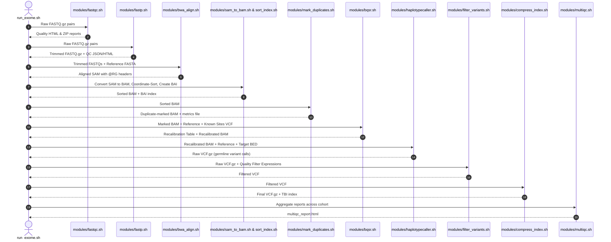
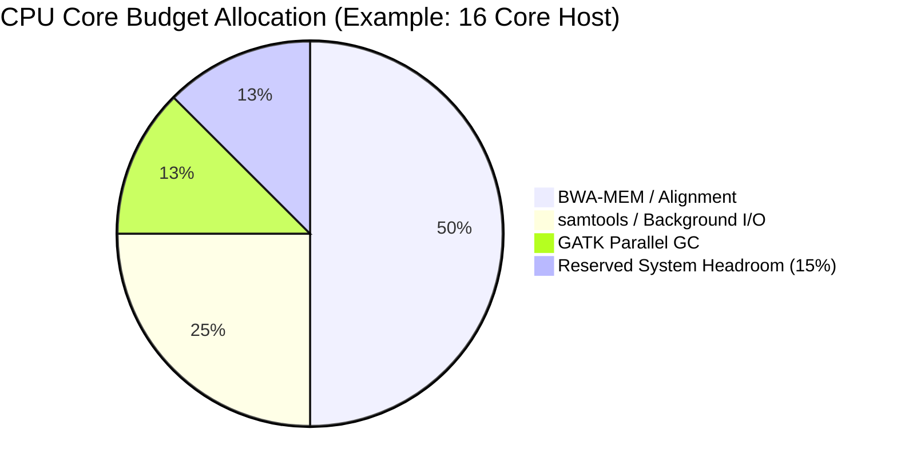
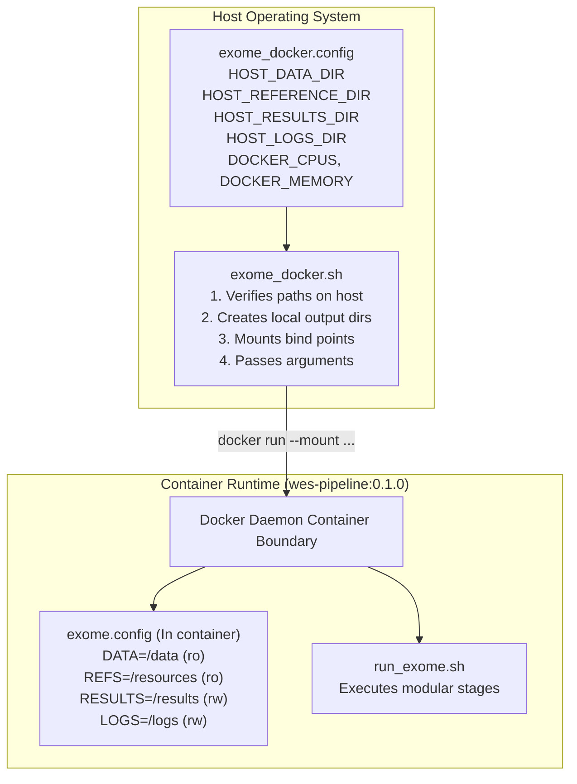

# Systems Architecture & Technical Specification

This document provides a comprehensive technical reference for the Whole Exome Sequencing pipeline architecture, covering module contracts, biological rationale, computational resource boundaries, and runtime orchestration.

---

## 1. Architectural Philosophy & Systems Design

Bioinformatics pipelines are long-running state machines that consume high I/O bandwidth, significant RAM, and multiple CPU cores. Failures late in execution incur substantial computational cost. 

To ensure maximum maintainability and operational resilience, this pipeline adheres to core systems design tenets:

1. **Separation of Concerns**: Pipeline orchestration, execution logic, environment management, and runtime configuration are strictly partitioned. The runner script does not define paths; module scripts do not define global cohort metadata.
2. **Explicit Interface Contracts**: Every module receives its requirements via explicit positional parameters and produces declared, predictable file outputs.
3. **Fail-Fast Error Propagation**: All scripts enforce `set -euo pipefail`. Any pipe component failure immediately aborts execution, preventing corrupted intermediate files from cascading downstream.
4. **Idempotence & Diagnostic Traceability**: Operations yield explicit per-sample log files tagged with start, end, and duration timestamps. Intermediate outputs are structured identically across runs.

---

## 2. End-to-End Pipeline Data Flow

The following sequence details data transformation across the eleven analytical stages:

---

## 3. Detailed Stage-by-Stage Biological & Technical Rationale

### Stage 1: Raw Read Quality Assessment (`modules/fastqc.sh`)
- **Biological / Analytical Purpose**: Illumina sequencing platforms suffer from error modes including base quality decay toward 3' ends, optical tile artifacts, and abnormal GC skew indicative of PCR over-amplification or biological contamination.
- **Implementation**: Executes `fastqc` on both forward (R1) and reverse (R2) reads. Output HTML and ZIP files are preserved for downstream cohort aggregation.

### Stage 2: Adapter and Quality Trimming (`modules/fastp.sh`)
- **Biological / Analytical Purpose**: Read-through past short insert fragments into sequencing adapters introduces non-genomic sequence that prevents correct read mapping or produces spurious insertions. Low-quality base calls (Phred < 20) inflate mismatch error rates.
- **Implementation**: `fastp` automatically identifies and trims adapters in paired mode, performs polyG tail clipping (critical for two-color NovaSeq chemistries), and discards reads below a configured length threshold (`FASTP_MIN_LENGTH`, default 36 bp).

### Stage 3: Reference Alignment (`modules/bwa_align.sh`)
- **Biological / Analytical Purpose**: Matches paired sequencing reads to their coordinate origins in the reference genome (e.g., GRCh38).
- **Implementation**: Uses `bwa mem` (or `bwa-mem2`) with Burrows-Wheeler Transform algorithm. Crucially, the module injects an explicit `@RG` (Read Group) header (`ID`, `SM`, `PL:ILLUMINA`, `LB`, `PU`). Downstream GATK tools require Read Groups to differentiate sample origins and platform batches during duplicate marking and BQSR.

### Stage 4 & 5: Format Conversion, Sorting, and Indexing (`modules/sam_to_bam.sh`, `modules/sort_index.sh`)
- **Technical Purpose**: Text-based SAM format is non-indexed and voluminous. SAM files are streamed into binary compressed BAM format, sorted by genomic coordinates (`samtools sort`), and indexed (`samtools index` creating `.bai`). This allows constant-time $O(1)$ random access across target regions.
- **I/O Optimization**: Unless `KEEP_INTERMEDIATE_BAM="true"` is set, uncompressed intermediate SAM files are removed immediately upon successful BAM generation to prevent disk exhaustion.

### Stage 6: Duplicate Read Identification (`modules/mark_duplicates.sh`)
- **Biological / Analytical Purpose**: PCR amplification during library construction and optical clustering on flow cells create duplicate copies of the same original DNA fragment. If treated as independent observations, duplicates artificially inflate variant allele frequencies and cause false-positive variant calls.
- **Implementation**: GATK Picard `MarkDuplicates` locates read pairs sharing identical 5' alignment coordinates and orientation, selects the pair with the highest sum of base qualities as the primary record, and sets bitwise SAM flag `0x0400` on duplicates so downstream callers ignore them without deleting the raw data.

### Stage 7: Base Quality Score Recalibration (`modules/bqsr.sh`)
- **Biological / Analytical Purpose**: Phred quality scores emitted by sequencers reflect machine estimations rather than empirical error probabilities. Systematic physical errors (chemistry batch, cycle position, dinucleotide context) cause Phred scores to diverge from actual mismatch frequencies.
- **Implementation**: 
  1. `BaseRecalibrator` compares observed mismatches against known polymorphic variation databases (dbSNP, 1000 Genomes). Mismatches at known sites are treated as biological SNPs, while mismatches outside known sites are counted as sequencing errors to build an empirical covariate recalibration table.
  2. `ApplyBQSR` adjusts the original base qualities in the BAM based on the covariate model.

### Stage 8 & 9: Germline Variant Discovery (`modules/haplotypecaller.sh`)
- **Biological / Analytical Purpose**: Identifies germline SNVs and short indels.
- **Implementation**: `HaplotypeCaller` identifies candidate active regions displaying variation, discards the existing alignment, performs local de-novo graph-based assembly of the reads in each active region, aligns candidate haplotypes against the reference via PairHMM, and calculates genotype likelihoods using Bayesian inference. Restricting calling to exome capture boundaries via `TARGET_BED` (`-L`) reduces runtime by >90% compared to whole-genome scanning.

### Stage 10: Variant Hard-Filtering (`modules/filter_variants.sh`)
- **Biological / Analytical Purpose**: Raw callsets contain false-positive candidate variants caused by mapping artifacts, strand bias, and poor coverage.
- **Implementation**: Applies standard quality filtering thresholds via GATK `VariantFiltration`:
  - `QD < 2.0` (QualByDepth): Normalizes variant quality by unfiltered read depth. Low QD indicates low confidence relative to coverage.
  - `FS > 60.0` (FisherStrand): Phred-scaled p-value using Fisher's exact test to detect strand bias (variant observed predominantly on forward or reverse strand).
  - `MQ < 40.0` (RMSMappingQuality): Root mean square of mapping quality across reads supporting variant.
  - `MQRankSum < -12.5`: Mann-Whitney rank sum test comparing mapping qualities of reads supporting reference vs alternate allele.
  - `ReadPosRankSum < -8.0`: Tests whether variant calls occur systematically near read ends.
  - `SOR > 3.0` (StrandOddsRatio): Secondary assessment for strand bias.

### Stage 11: Release Compression & Indexing (`modules/compress_index.sh`)
- **Technical Purpose**: Produces immutable, standard-compliant release assets. Uses `bgzip` to apply block-level gzip compression, followed by `tabix -p vcf` to generate a `.tbi` index for rapid retrieval by genomic coordinates.

### Cohort Quality Summary (`modules/multiqc.sh`)
- **Technical Purpose**: Recursively scans all output subdirectories, parses reports from FastQC, fastp, and GATK MarkDuplicates metrics, and generates an interactive cohort-wide HTML dashboard (`results/reports/multiqc_report.html`).

---

## 4. Module Interface Contracts

| Stage | Script | Positional Arguments | Expected Inputs | Primary Outputs | Exit Code Policy |
|---|---|---|---|---|---|
| **1** | `modules/fastqc.sh` | `$1`: sample `$2`: r1 `$3`: r2 `$4`: out_dir `$5`: threads | Paired FASTQ.gz files | `<sample>_R1_fastqc.html` `<sample>_R2_fastqc.html` | Exits `0` on success, `2` on bad args, `>0` on tool error |
| **2** | `modules/fastp.sh` | `$1`: sample `$2`: r1 `$3`: r2 `$4`: out_dir `$5`: threads `$6`: min_len `$7`: phred | Paired FASTQ.gz files | `<sample>_R1.trimmed.fastq.gz` `<sample>_R2.trimmed.fastq.gz` `<sample>_fastp.html/json` | Exits `0` on success, `2` on bad args, `>0` on tool error |
| **3** | `modules/bwa_align.sh` | `$1`: sample `$2`: trim1 `$3`: trim2 `$4`: out_dir `$5`: ref `$6`: threads `$7`: bwa_bin | Trimmed FASTQs + Ref FASTA | `<sample>.sam` (with `@RG` header) | Exits `0` on success, `2` on bad args, `>0` on tool error |
| **4** | `modules/sam_to_bam.sh` | `$1`: sample `$2`: in_sam `$3`: out_dir `$4`: threads `$5`: keep_sam | Input SAM | `<sample>.bam` | Exits `0` on success, `2` on bad args, `>0` on tool error |
| **5** | `modules/sort_index.sh` | `$1`: sample `$2`: in_bam `$3`: out_dir `$4`: threads `$5`: keep_unsorted | Raw BAM | `<sample>.sorted.bam` `<sample>.sorted.bam.bai` | Exits `0` on success, `2` on bad args, `>0` on tool error |
| **6** | `modules/mark_duplicates.sh` | `$1`: sample `$2`: in_bam `$3`: out_dir `$4`: java_opts `$5`: val_str `$6`: rm_dups | Coordinate-sorted BAM | `<sample>.dedup.bam` `<sample>.dedup.metrics.txt` | Exits `0` on success, `2` on bad args, `>0` on tool error |
| **7** | `modules/bqsr.sh` | `$1`: sample `$2`: in_bam `$3`: ref `$4`: known_vcf `$5`: out_dir `$6`: java_opts | Dedup BAM + Known Sites VCF | `<sample>.recal_data.table` `<sample>.bqsr.bam` | Exits `0` on success, `2` on bad args, `>0` on tool error |
| **8-9** | `modules/haplotypecaller.sh` | `$1`: sample `$2`: in_bam `$3`: ref `$4`: target_bed `$5`: out_dir `$6`: java_opts `$7`: extra_args | Recalibrated BAM + Target BED | `<sample>.raw.vcf.gz` `<sample>.raw.vcf.gz.tbi` | Exits `0` on success, `2` on bad args, `>0` on tool error |
| **10** | `modules/filter_variants.sh` | `$1`: sample `$2`: in_vcf `$3`: ref `$4`: out_dir `$5`: java_opts `$6`: expr `$7`: name | Raw VCF.gz | `<sample>.filtered.vcf` | Exits `0` on success, `2` on bad args, `>0` on tool error |
| **11** | `modules/compress_index.sh` | `$1`: sample `$2`: in_vcf `$3`: out_dir | Filtered VCF | `<sample>.filtered.vcf.gz` `<sample>.filtered.vcf.gz.tbi` | Exits `0` on success, `2` on bad args, `>0` on tool error |
| **QC** | `modules/multiqc.sh` | `$1`: results_dir `$2`: reports_dir | Full results directory | `multiqc_report.html` | Exits `0` on success, `1` on missing results dir |

---

## 5. Resource Management & Headroom Formula

Resource exhaustion is the primary source of pipeline crashes on production HPC infrastructure and local workstations.

### The 15% System Headroom Rule
Bioinformatics tools heavily exercise memory bandwidth, disk page cache, and inter-process pipes. If userland processes request 100% of logical CPU cores and physical memory:
1. Linux kernel background flusher threads (`kswapd`, `kworker`) are starved.
2. High context-switch latency causes process stalls.
3. The Linux Out-Of-Memory (OOM) killer arbitrarily terminates processes.

**Operational Rule**: Always cap maximum tool thread allocations at:
$$\text{Max Allocated Threads} \le \lfloor 0.85 \times \text{Total System Logical Cores} \rfloor$$

### JVM Memory Management
Java-based GATK tools allocate heap memory independently of tool thread pools. Every GATK invocation in this pipeline passes explicit memory limits via `GATK_JAVA_OPTIONS`:
- `-Xmx16g`: Maximum heap allocation capped at 16 GB.
- `-XX:ParallelGCThreads=4`: Constrains garbage collection threads to avoid spawning CPU threads that contend with alignment steps.
- `-Djava.io.tmpdir=/tmp`: Directs large scratch spillover to local scratch rather than network file shares.

---

## 6. Docker Container & Host Namespace Isolation

Production deployment uses a two-tier configuration model to bridge host storage and container execution without hardcoding host machine layouts inside the container image:

### Boundary Translation Rules:
1. **Read-Only Invariance**: Inputs (`/data`) and reference files (`/resources`) are mounted with `readonly` flags. Even if a module misbehaves, input raw data cannot be overwritten or deleted.
2. **Path Abstraction**: The samplesheet passed to the container uses container-relative paths (`/data/sample1_R1.fastq.gz`), allowing identical samplesheets to run across different physical host machines without modification.
3. **Hard Resource Limits**: The container is invoked with `--cpus` and `--memory` limits enforced by cgroups, guaranteeing that the pipeline process cannot consume host-critical resources.
