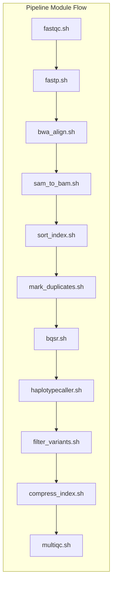
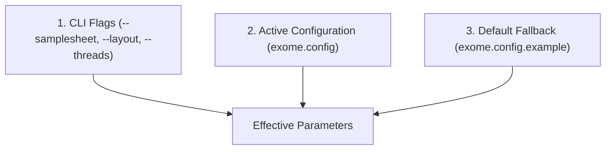
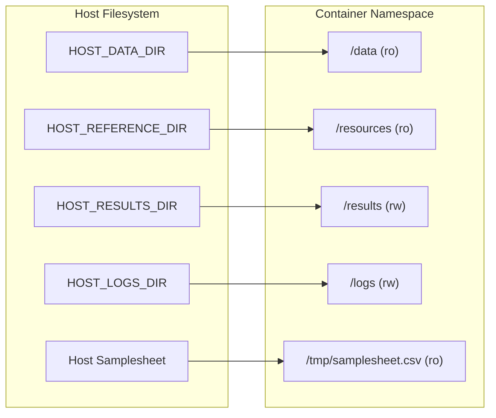

# System Architecture Specifications

This specification describes the data contracts, modular interfaces, and execution model for the Whole Exome Sequencing pipeline.

## 1. Modular Processing Contract

Each stage in `modules/` is designed as an isolated shell script with deterministic arguments and strict error handling (`set -euo pipefail`).

## 2. Interface Specifications

| Step | Script | Input Parameters | Produced Output |
|---|---|---|---|
| 1 | `modules/fastqc.sh` | sample, fastq1, fastq2, out_dir, threads | HTML and ZIP quality reports |
| 2 | `modules/fastp.sh` | sample, fastq1, fastq2, out_dir, threads, min_len, phred | Trimmed FASTQs + JSON/HTML reports |
| 3 | `modules/bwa_align.sh` | sample, trim1, trim2, out_dir, ref, threads, bwa_bin | Alignment SAM with @RG header |
| 4 | `modules/sam_to_bam.sh` | sample, sam_in, out_dir, threads, keep_sam | Unsorted binary BAM |
| 5 | `modules/sort_index.sh` | sample, bam_in, out_dir, threads, keep_unsorted | Coordinate-sorted BAM + BAI index |
| 6 | `modules/mark_duplicates.sh` | sample, bam_in, out_dir, java_opts, val_str, rm_dups | Marked BAM + duplicate metrics |
| 7 | `modules/bqsr.sh` | sample, bam_in, ref, known_sites, out_dir, java_opts | Recalibration table + BQSR BAM |
| 8 | `modules/haplotypecaller.sh` | sample, bam_in, ref, target_bed, out_dir, java_opts, args | Raw VCF/gVCF (`.raw.vcf.gz`) |
| 9 | `modules/filter_variants.sh` | sample, vcf_in, ref, out_dir, java_opts, expr, name | Filtered VCF |
| 10 | `modules/compress_index.sh` | sample, vcf_in, out_dir | Final `VCF.gz` + `TBI` index |
| 11 | `modules/multiqc.sh` | results_dir, reports_dir | Cohort `multiqc_report.html` |

## 3. Configuration Priority Model

Configuration values follow a cascading priority hierarchy:

The runner script (`run_exome.sh`) does not declare hardcoded paths or settings. All defaults originate in `exome.config`.

## 4. Resource Allocation & Headroom

To avoid CPU starvation and out-of-memory errors on shared HPC or local nodes:
- Keep at least 15% system CPU headroom unallocated for I/O operations.
- Explicit JVM heap sizing is applied to all Java tools via `GATK_JAVA_OPTIONS`.
- Intermediate uncompressed SAM files are cleaned immediately upon successful BAM generation unless `--keep-intermediate` is requested.

## 5. Container Bind-Mount Architecture

The host wrapper `exome_docker.sh` isolates the pipeline inside a container:

