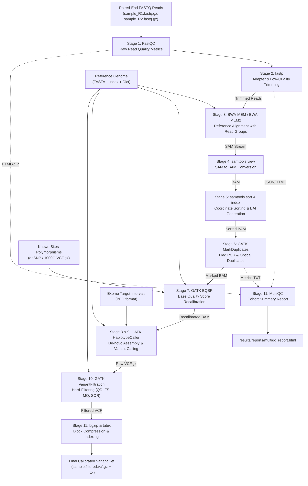

# Whole Exome Sequencing (WES) Pipeline

A modular, production-ready Whole Exome Sequencing pipeline implementing a decoupled systems-design architecture. Built to process paired-end Illumina short reads into high-confidence, analysis-ready germline single-nucleotide variants (SNVs) and small insertions/deletions (indels).

---

## Table of Contents

- [Overview & Philosophy](#overview--philosophy)
- [Workflow Pipeline Overview](#workflow-pipeline-overview)
- [Repository Directory Structure](#repository-directory-structure)
- [Toolchain & Pinned Dependencies](#toolchain--pinned-dependencies)
- [Configuration System](#configuration-system)
  - [Cascading Precedence](#cascading-precedence)
  - [Key Configuration Parameters](#key-configuration-parameters)
- [Samplesheet Specifications](#samplesheet-specifications)
- [Results Organization Layouts](#results-organization-layouts)
  - [Option 1: Sample-Centric Layout (Default)](#option-1-sample-centric-layout-default)
  - [Option 2: Stage-Centric Layout](#option-2-stage-centric-layout)
- [Quick Start Guide](#quick-start-guide)
  - [Step 1: Environment Setup](#step-1-environment-setup)
  - [Step 2: Generate Synthetic Test Data](#step-2-generate-synthetic-test-data)
  - [Step 3: Run Automated Smoke Tests](#step-3-run-automated-smoke-tests)
  - [Step 4: Running the Pipeline](#step-4-running-the-pipeline)
- [Production Containerization (Docker)](#production-containerization-docker)
  - [Building the Container Image](#building-the-container-image)
  - [Host Bind-Mount Execution Wrapper](#host-bind-mount-execution-wrapper)
  - [Offline Transfer (`docker save` & `docker load`)](#offline-transfer-docker-save--docker-load)
- [Testing & Validation Strategy](#testing--validation-strategy)
- [Reference Genome & Resource Setup](#reference-genome--resource-setup)
- [License](#license)

---

## Overview & Philosophy

In modern bioinformatics, workflows frequently struggle with brittle scripts, hardcoded absolute paths, tightly coupled environment assumptions, and unmanaged compute contention. 

This repository treats bioinformatics pipeline development as a disciplined **systems design** problem:

1. **Strict Decoupling of Logic and Configuration**: The orchestrator script (`run_exome.sh`) contains zero hardcoded parameters, file names, or path assignments. Every setting is populated from an external configuration file (`exome.config`) and can be dynamically overridden at the command line.
2. **Modular Single-Responsibility Stages**: Each analytical step (`FastQC`, `fastp`, `BWA-MEM`, `samtools`, `GATK MarkDuplicates`, `GATK BQSR`, `GATK HaplotypeCaller`, `GATK VariantFiltration`, `bgzip/tabix`, and `MultiQC`) is encapsulated within an isolated, self-contained shell script in `modules/`. Modules can be executed standalone or stitched together.
3. **Deterministic Environments**: Software tools and libraries are strictly pinned through `environment.yml` and reproducible container definitions (`Dockerfile`) based on minimal Micromamba runtimes.
4. **Predictable Resource Allocation**: Enforces the 15% system headroom reserve rule to prevent memory starvation and thread thrashing on shared compute nodes.
5. **Configurable Output Taxonomies**: Provides native support for both sample-centric (per-patient folders) and stage-centric (per-tool folders) layouts.

---

## Workflow Pipeline Overview

The pipeline executes a standardized linear analytical flow for each paired-end library:



---

## Repository Directory Structure

```text
exome-pipeline/
├── .dockerignore                  # Exclusions for container build context
├── .gitignore                     # Exclusions for data, results, temporary files, and local configs
├── Dockerfile                     # Pinned Micromamba container definition (v1.5.8)
├── environment.yml                # Conda package specifications with pinned versions
├── conda-lock.yml                 # Multi-platform lockfile instructions and specifications
├── exome.config                   # Active local pipeline configuration
├── exome.config.example           # Documented template configuration
├── exome_docker.sh                # Host-side execution wrapper for containerized runs
├── exome_docker.config.example    # Host directory mount mappings template
├── run_exome.sh                   # Main orchestrator runner script
├── README.md                      # Project manual and execution guide
├── ARCHITECTURE.md                # In-depth architectural design and component contracts
├── samplesheets/
│   ├── default.csv                # Template cohort samplesheet
│   └── test.csv                   # Synthetic test samplesheet
├── modules/                       # Reusable stage scripts
│   ├── fastqc.sh                  # Quality control profiling
│   ├── fastp.sh                   # Adapter and quality trimming
│   ├── bwa_align.sh               # Sequence alignment to reference
│   ├── sam_to_bam.sh              # Format conversion
│   ├── sort_index.sh              # Coordinate sorting and random-access indexing
│   ├── mark_duplicates.sh         # PCR/optical duplicate identification
│   ├── bqsr.sh                    # Base quality score recalibration
│   ├── haplotypecaller.sh         # Germline variant discovery
│   ├── filter_variants.sh         # Quality hard-filtering
│   ├── compress_index.sh          # Final bgzip compression and tabix indexing
│   └── multiqc.sh                 # Aggregated cohort quality reporting
├── resources/                     # Reference files and intervals
│   ├── reference/README.md        # Reference genome placement instructions
│   ├── known_sites/README.md      # Polymorphic sites placement instructions
│   └── intervals/README.md        # Exome capture BED placement instructions
├── scripts/
│   └── generate_synthetic_test_data.py # Deterministic synthetic test generator
└── tests/
    └── smoke_test.sh              # Automated test suite and validation harness
```

---

## Toolchain & Pinned Dependencies

All bioinformatics tools are pinned to exact versions in `environment.yml`:

| Tool | Pinned Version | Function in Pipeline |
|---|---|---|
| **FastQC** | `0.12.1` | Assesses per-base sequence quality, adapter content, GC distribution |
| **fastp** | `0.23.4` | Performs quality trimming, polyG clipping, adapter auto-detection |
| **BWA / BWA-MEM2** | `0.7.17` / `2.2.1` | Aligns read pairs against the reference genome with read group headers |
| **samtools** | `1.19.2` | Converts SAM to BAM, performs coordinate sorting and BAI indexing |
| **GATK4** | `4.5.0.0` | Picard MarkDuplicates, BaseRecalibrator, HaplotypeCaller, VariantFiltration |
| **htslib** | `1.19.1` | Provides `bgzip` block compression and `tabix` coordinate indexing |
| **MultiQC** | `1.21` | Aggregates outputs from FastQC, fastp, and Picard into a single HTML report |
| **seqtk** | `1.4` | FASTQ/FASTA sequence manipulation and deterministic paired subsampling |

---

## Configuration System

### Cascading Precedence

The pipeline resolves runtime parameters according to strict cascading priority:

```text
1. Command-Line Arguments  (e.g., --samplesheet cohort.csv --threads 16)
         ↓ overrides
2. Active Configuration    (./exome.config)
         ↓ fallback if missing
3. Example Template        (./exome.config.example)
```

### Key Configuration Parameters

Parameters configured in `exome.config` include:

- `SAMPLESHEET`: Path to input metadata CSV (`samplesheets/test.csv`).
- `LAYOUT`: Output layout strategy (`"sample"` or `"stage"`).
- `REFERENCE`: Path to reference genome FASTA (`resources/reference/mini_ref.fa`).
- `KNOWN_SITES`: Path to bgzipped, tabix-indexed known variants VCF.
- `TARGET_BED`: Path to exome capture interval target BED file.
- `TOTAL_THREADS`: Core budget for multi-threaded operations.
- `GATK_JAVA_OPTIONS`: JVM heap ceiling (e.g. `-Xmx16g -XX:ParallelGCThreads=4 -Djava.io.tmpdir=/tmp`).
- `KEEP_INTERMEDIATE_BAM`: Set to `"false"` to delete raw SAM/unsorted BAM upon sorted BAM verification.
- `RUN_MULTIQC`: Toggle cohort-level reporting (`"true"` / `"false"`).

---

## Samplesheet Specifications

Input reads are supplied via a standard comma-separated samplesheet:

```csv
sample,patient,fastq_1,fastq_2
NA12878,patient_01,/data/NA12878_R1.fastq.gz,/data/NA12878_R2.fastq.gz
NA12879,patient_02,/data/NA12879_R1.fastq.gz,/data/NA12879_R2.fastq.gz
```

- **sample**: Unique sample identifier used in directory names, read groups (`SM:` tag), and VCF sample columns.
- **patient**: Subject/patient ID for cohort tracking.
- **fastq_1 / fastq_2**: Absolute or pipeline-relative paths to forward and reverse paired-end FASTQs.

---

## Results Organization Layouts

The orchestrator supports two distinct output structures, configured via `LAYOUT`:

### Option 1: Sample-Centric Layout (Default)
Groups every intermediate and final product for a sample within a single directory tree. Ideal for single-patient diagnostic review and sample-level archival:

```text
results/
├── sample1/
│   ├── fastqc/              # sample1_R1_fastqc.html, sample1_R2_fastqc.html
│   ├── trimmed_fastq/       # sample1_R1.trimmed.fastq.gz, sample1_fastp.html
│   ├── alignment/           # sample1.sam (if retained)
│   ├── bam/                 # sample1.bam
│   ├── sorted/              # sample1.sorted.bam, sample1.sorted.bam.bai
│   ├── duplicate_marked/    # sample1.dedup.bam, sample1.dedup.metrics.txt
│   ├── bqsr/                # sample1.recal_data.table, sample1.bqsr.bam
│   ├── raw_vcf/             # sample1.raw.vcf.gz
│   ├── filtered_vcf/        # sample1.filtered.vcf
│   └── final_vcf/           # sample1.filtered.vcf.gz, sample1.filtered.vcf.gz.tbi
├── sample2/
│   └── ...
└── reports/
    └── multiqc_report.html  # Aggregated cohort summary
```

### Option 2: Stage-Centric Layout
Organizes files by processing step across all samples. Ideal for batch QC inspections and multi-sample comparisons:

```text
results/
├── fastqc/                  # All samples FastQC reports
├── trimmed_fastq/           # All samples trimmed reads & fastp reports
├── sorted/                  # All coordinate-sorted BAMs & BAIs
├── duplicate_marked/        # All duplicate-marked BAMs & metrics
├── bqsr/                    # Recalibration tables & recalibrated BAMs
├── final_vcf/               # All final release VCF.gz and TBI files
└── reports/
    └── multiqc_report.html
```

---

## Quick Start Guide

### Step 1: Environment Setup

Create and activate the Conda environment using either Conda, Mamba, or Micromamba:

```bash
conda env create -f environment.yml
conda activate exome
```

### Step 2: Generate Synthetic Test Data

A self-contained synthetic data generator is included to generate mock paired-end reads, reference contigs, and annotations:

```bash
python3 scripts/generate_synthetic_test_data.py
```

This populates:
- `test_data/test_sample_R1.fastq.gz` & `R2.fastq.gz` (synthetic paired reads)
- `resources/reference/mini_ref.fa` (+ `.fai` and `.dict`)
- `resources/known_sites/known_sites.vcf.gz` (+ `.tbi`)
- `resources/intervals/exome_targets.bed`

### Step 3: Run Automated Smoke Tests

Verify script permissions, module interfaces, and dry-run directory creation:

```bash
bash tests/smoke_test.sh
```

### Step 4: Running the Pipeline

Execute a dry run to inspect the workflow without executing computational tools:
```bash
./run_exome.sh --samplesheet samplesheets/test.csv --dry-run
```

Execute the full pipeline locally:
```bash
./run_exome.sh --samplesheet samplesheets/test.csv
```

Override specific settings at runtime:
```bash
./run_exome.sh \
  --samplesheet samplesheets/test.csv \
  --layout stage \
  --threads 8 \
  --results-dir my_custom_results/
```

---

## Production Containerization (Docker)

Containerization isolates tool dependencies, compiler versions, and libraries from the host OS.

### Building the Container Image

Build the container image using the pinned Micromamba base:

```bash
docker build --tag wes-pipeline:0.1.0 .
```

### Host Bind-Mount Execution Wrapper

Because data files and reference datasets should never be baked into container images, the pipeline uses a host-side execution wrapper (`exome_docker.sh`) with an external configuration (`exome_docker.config`).

1. Copy the example Docker configuration:
   ```bash
   cp exome_docker.config.example exome_docker.config
   ```

2. Configure your host directories in `exome_docker.config`:
   ```bash
   IMAGE_NAME="wes-pipeline:0.1.0"
   HOST_DATA_DIR="/path/to/host/fastq"
   HOST_REFERENCE_DIR="/path/to/host/references"
   HOST_RESULTS_DIR="/path/to/host/results"
   HOST_LOGS_DIR="/path/to/host/logs"
   DOCKER_CPUS="8"
   DOCKER_MEMORY="32g"
   ```

3. Launch the containerized pipeline:
   ```bash
   ./exome_docker.sh --samplesheet samplesheets/test.csv
   ```

The wrapper binds:
- Host data and reference folders as **read-only** (`ro`)
- Host results and logs folders as **read-write** (`rw`)
- Enforces strict Docker CPU and memory resource limits.

### Offline Transfer (`docker save` & `docker load`)

For secure or air-gapped environments lacking internet access:

```bash
# On build machine:
docker save wes-pipeline:0.1.0 | gzip > wes-pipeline_0.1.0.tar.gz

# On deployment machine:
gunzip -c wes-pipeline_0.1.0.tar.gz | docker load
```

---

## Testing & Validation Strategy

The pipeline distinguishes between two testing stages:

1. **Smoke Testing**: Exercises each module and orchestrator flag on a minimal read set (e.g. 100 reads) to verify path translation, file handoffs, exit codes, and indexing. Runs in seconds without heavy compute.
2. **Scientific Validation**: Executed on standardized reference materials (such as Genome in a Bottle `HG001` / `NA12878`) to evaluate sensitivity, precision, and transition/transversion (Ti/Tv) ratios against high-confidence benchmark truth sets before production deployment.

---

## Reference Genome & Resource Setup

For production runs with human exomes:
1. **Reference Genome**: Place `GRCh38.fa` (or `b37`/`hg19`), along with `samtools faidx` index (`.fai`), sequence dictionary (`.dict`), and BWA indexes (`.bwt`, `.pac`, `.ann`, `.amb`, `.sa`) in `resources/reference/`.
2. **Known Sites**: Place dbSNP (`dbsnp_146.hg38.vcf.gz`) and Mills/1000G gold standard indels in `resources/known_sites/`.
3. **Capture Targets**: Place the vendor-specific exome capture BED file in `resources/intervals/`.

---

## License

This project is licensed under the [MIT License](LICENSE).
