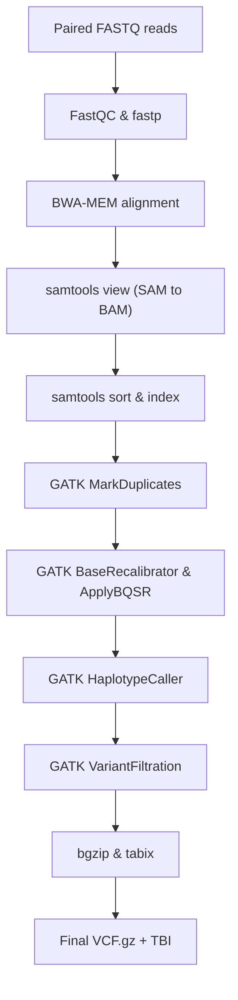

# Exome Pipeline (WES)

A modular Whole Exome Sequencing pipeline implementation following decoupled systems architecture.

## Architecture Summary

The pipeline implements an end-to-end WES workflow from paired-end FASTQ reads to filtered VCF files:



## Repository Structure

- `run_exome.sh`: Main workflow orchestrator with CLI argument overrides.
- `exome.config` / `exome.config.example`: Configuration file assigning all variables, resource limits, and paths.
- `exome_docker.sh` / `exome_docker.config.example`: Host wrapper managing Docker bind-mounts and resource limits.
- `Dockerfile`: Reproducible container image based on Micromamba.
- `environment.yml`: Pinned bioinformatics environment specification.
- `modules/`: Discrete single-responsibility bash modules for each processing stage.
- `samplesheets/`: Sample metadata sheets (`sample,patient,fastq_1,fastq_2`).
- `resources/`: Target BED intervals, reference genome indexes, and known variant sites.
- `scripts/`: Utilities including synthetic test data generation.
- `tests/`: Smoke test suite.

## Quick Start

### 1. Generate Synthetic Test Data
```bash
python3 scripts/generate_synthetic_test_data.py
```

### 2. Run Smoke Tests
```bash
bash tests/smoke_test.sh
```

### 3. Execute Pipeline

#### Option A: Using Docker (Recommended for Production)

**Step 1: Build the Docker Image**
```bash
docker build --tag wes-pipeline:0.1.0 .
```

*(Optional) Export and load for offline deployment:*
```bash
# Export compressed image
docker save wes-pipeline:0.1.0 | gzip > wes-pipeline_0.1.0.tar.gz

# Load image on target system
gunzip -c wes-pipeline_0.1.0.tar.gz | docker load
```

**Step 2: Configure Host Mounts and Run**
```bash
# Create local host configuration
cp exome_docker.config.example exome_docker.config

# Edit host paths (HOST_DATA_DIR, HOST_REFERENCE_DIR, etc.) in exome_docker.config
# Then execute through the host wrapper
./exome_docker.sh --samplesheet samplesheets/test.csv
```

#### Option B: Using Local Conda / Micromamba

```bash
# Create and activate environment
conda env create -f environment.yml
conda activate exome

# Dry-run validation
./run_exome.sh --samplesheet samplesheets/test.csv --dry-run

# Run full pipeline
./run_exome.sh --samplesheet samplesheets/test.csv
```

## Output Layout Options

Configured via `LAYOUT` in `exome.config`:
- `sample`: Group all files under `results/<sample_id>/<stage>/`
- `stage`: Group all files under `results/<stage>/<sample_id>.*`
